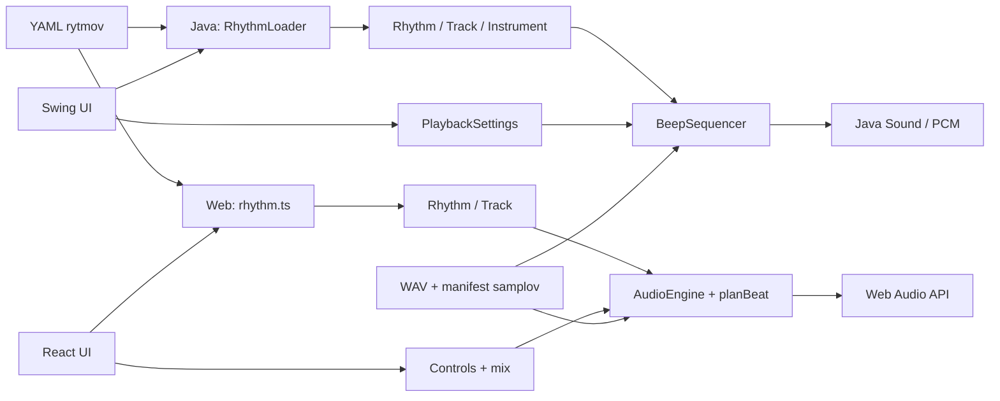
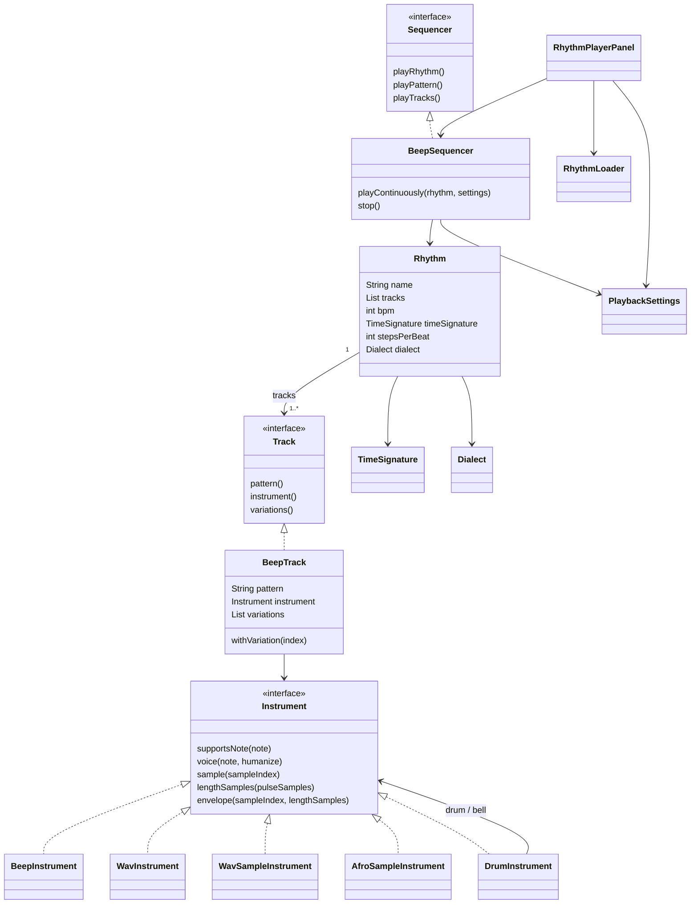

# Technická dokumentácia JavAfro

Dokument je určený programátorovi, ktorý potrebuje pochopiť súčasnú implementáciu,
nájsť miesto pre zmenu alebo rozšíriť prehrávač. Popisuje Java desktopovú aj
webovú verziu. Cesty v dokumente sú relatívne ku koreňu repozitára; odkazy sú
relatívne k tomuto súboru. Používateľský formát YAML a ovládanie podrobnejšie
opisuje [hlavné README](../README.md), webové spustenie [web/README.md](../web/README.md).

## 1. Architektúra a adresáre

JavAfro má dva samostatné prehrávače. Desktop používa Java/Swing a Java Sound;
web používa React/TypeScript, CodeMirror a Web Audio API. Web nepotrebuje Java
backend. Implementácie zdieľajú súbory rytmov, konfiguráciu a manifest samplov,
nie spustené Java objekty ani spoločný sekvencer.

| Cesta | Obsah a zodpovednosť |
| --- | --- |
| `src/main/java/picosoft/javafro` | Java aplikácia, doménový model, parser, UI a audio engine. |
| `src/main/resources/samples` | WAV súbory, manifest `afroplayer-samples.yaml` a informácie o pôvode samplov. |
| `src/main/resources/icons` | Ikony desktopovej aj webovej aplikácie. |
| `src/main/resources/app-info.properties` | Šablóna metadát filtrovaná Mavenom. |
| `rhythms` | Knižnica YAML rytmov vrátane importov a šablóny nového rytmu. |
| `javafro.yaml` | Spoločné predvolené nastavenia aplikácie. |
| `web/src` | Webové UI, parser, plánovanie úderov a audio engine. |
| `web/scripts`, `web/build` | Synchronizácia dát, offline build, lokálny HTTPS server a obfuskácia. |
| `src/test/java`, `web/src/*.test.ts` | Automatické testy oboch implementácií. |
| `tools` | Importy rytmov, príprava samplov a kontrola obfuskovaného JAR. |
| `docs/tasks` | Evidencia úloh; neobsahuje aplikačný kód. |



## 2. Objektová štruktúra Java

Základný balík je `picosoft.javafro`. Dátový model je v `base`, konkrétne
prehrávanie v `sequencer`, zvukové zdroje v `instruments`, načítanie v `io`
a Swing komponenty v `ui`.



### Doménový model: `base`

| Typ | Zodpovednosť a dôležité pravidlá |
| --- | --- |
| `Rhythm` | Record s názvom, trackmi, BPM, metrom, delením doby a dialectom. Validuje povinné hodnoty a dĺžky základných aj variačných patternov. Ukladá nemennú kópiu zoznamu trackov. Neobsahuje stav prehrávania ani mixer. |
| `Track` | Rozhranie jednej rytmickej stopy: `pattern()`, `instrument()` a voliteľné `variations()`. |
| `Instrument` | Kontrakt zdroja zvuku. Pozná podporované noty, vytvára zvuk konkrétneho úderu a poskytuje jeho vzorky, dĺžku a obálku. Má aj pomocné blokujúce `playTone()`. |
| `Sequencer` | Rozhranie konečného prehrávania rytmu, patternu alebo viacerých stôp. Preťaženia dopĺňajú predvolené opakovanie a humanizáciu. Nepretržité prehrávanie poskytuje konkrétny `BeepSequencer`. |
| `TimeSignature` | Record metra. Parsuje napr. `4/4` alebo `12/8`, počíta kroky na takt a predvolené delenie doby. `expandPattern()` zdvojí presne polovičný zápis taktu; každý úsek oddelený `\|` posudzuje samostatne. |
| `Dialect` | Record nemenného zoznamu nezávislých posunov pulzov −1 až +1. Hodnota ±1 znamená polovicu rovného kroku. `minimumGap()` vypočíta najkratšiu medzeru vrátane prechodu do ďalšej doby. |
| `AudioConstants` | Spoločný Java audio formát a konštanty časovania. Výstup je 44 100 Hz, signed PCM, 16 bitov, mono, little-endian. `putSample()` aplikuje master gain, oreže amplitúdu a zapíše PCM. |
| `BeepInstrument` | Jednoduchý sínusový nástroj s nastaviteľnou frekvenciou a krátkou obálkou. Slúži aj ako základ syntetických bubnov. |

Zdrojové súbory: [base](../src/main/java/picosoft/javafro/base).

### Prehrávanie: `sequencer`

| Typ | Zodpovednosť |
| --- | --- |
| `BeepTrack` | Implementácia `Track` ako record. Overuje syntax a podporu nôt nástrojom, uchováva nemenný zoznam variácií. `withVariation(index)` explicitne vyberie variáciu ako nový základný pattern. |
| `BeepSequencer` | Plánuje údery, vytvára ich hlasy, mieša prekrývajúce sa dozvuky a zapisuje PCM do `SourceDataLine`. Podporuje konečné aj nepretržité prehrávanie, tempo, dialect, humanizáciu, mixer a master. |
| `PlaybackSettings` | Bezpečne zdieľané živé nastavenia medzi UI a audio vláknom. Nahrádza snapshot tempa/humanizácie/dialectu, uchováva pravdepodobnosť humanizácie, master a mix jednotlivých trackov. |
| `PlaybackSettings.Values` | Nemenný snapshot `bpm`, `humanize` a `dialect`; aktuálna referencia je `volatile`. Settery snapshotu sú synchronizované. |
| `PlaybackSettings.TrackMix` | Nemenná dvojica interná hlasitosť 0–200 a mute. `gain()` vracia 0 pri mute, inak `volume / 100.0`. Záznamy sú v `ConcurrentHashMap` podľa indexu tracku. |
| `BeepSequencer.Voice` | Súkromný record jedného naplánovaného úderu: jeho `Instrument`, začiatok, dĺžka a index tracku. |
| `BeepSequencer.LineFactory` | Balíkové rozhranie pre vytvorenie audio linky; testy môžu dosadiť falošný výstup bez fyzickej zvukovej karty. |

Zdrojové súbory: [sequencer](../src/main/java/picosoft/javafro/sequencer).

`playContinuously()` blokuje volajúce vlákno. `stop()` je definitívny pre danú
inštanciu sekvencera: zastaví, vyprázdni a zatvorí aktívnu audio linku. Na ďalšie
prehrávanie sa vytvára nový `BeepSequencer`.

### Načítanie, konfigurácia a štart

| Trieda | Zodpovednosť |
| --- | --- |
| [`AfroJavaPlayer`](../src/main/java/picosoft/javafro/AfroJavaPlayer.java) | Vstupný bod. Na Swing EDT nastaví vzhľad, načíta konfiguráciu a voliteľný YAML z argumentu, zapne lokálnu obnovu konceptu a vytvorí okno. Pri zatváraní chráni neuloženú prácu a zastaví prehrávanie. |
| [`AppInfo`](../src/main/java/picosoft/javafro/AppInfo.java) | Sprístupňuje verziu a autorstvo z resource `app-info.properties`. |
| [`config.AppConfig`](../src/main/java/picosoft/javafro/config/AppConfig.java) | Record predvolených nastavení; načítanie a striktná validácia `javafro.yaml`, doplnenie chýbajúcich hodnôt a vyriešenie adresára knižnice. |
| [`io.RhythmLoader`](../src/main/java/picosoft/javafro/io/RhythmLoader.java) | Parsuje YAML cez SnakeYAML `SafeConstructor`, odmieta duplicitné kľúče a neznáme polia definície, vytvára `Rhythm`, `BeepTrack` a konkrétne nástroje. `load()` vracia mapu v poradí dokumentu; `atCaret()` vyberá rytmus podľa kurzora. |
| `io.DesktopDraftStore` | Verziovaný lokálny záznam aktuálneho a predchádzajúceho dokumentu, vrátane surového textu, kurzora, cesty, uloženej verzie a živého BPM/dialectu. Lock a porovnanie predchádzajúceho obsahu chránia novšiu verziu z iného okna; zápis používa dočasný súbor a move. |
| `io.RhythmExport` | Pri platnom dokumente upraví BPM/dialect vybraného rytmu cez SnakeYAML uzly so zachovaním komentárov. Neplatný alebo prázdny dokument vracia bezo zmeny. |

`AppConfig.load()` hľadá konfiguráciu v pracovnom priečinku, vedľa JAR,
pri balení cez jpackage aj vedľa spúšťača, potom v resources. Bez resource použije
`defaults()`. Relatívna `library.directory` sa odvodí od umiestnenia externého
konfiguračného súboru; pri pribalenej konfigurácii od pracovného priečinka.
Konfigurácia sa pri pohybe posuvníkov neprepisuje.

### Swing UI: `ui`

| Trieda alebo vnorený typ | Zodpovednosť |
| --- | --- |
| `RhythmPlayerPanel` | Hlavný panel a koordinátor desktopu: YAML editor, výber súboru, výber rytmu pod kurzorom, synchronizácia ovládania, Play/Stop, chyby a okno mixera. |
| `RhythmPlayerPanel.PlaybackSession` | Balíková abstrakcia životného cyklu prehrávania (`play`, `queue`, `cancelQueued`, `stop`, `isStopped`). Produkčne obaluje sekvencer, testy môžu vložiť vlastnú session cez factory. |
| `RhythmPlayerPanel.PlaybackRequest` | Súkromný record rytmu a nastavení pre konkrétne spustenie. Pri reštartoch sa uchováva iba posledná čakajúca požiadavka. |
| `MixerPanel` | Zostavuje ovládanie hlasitosti a mute podľa trackov, uchováva master a prepája hodnoty s aktuálnym `PlaybackSettings` cez `bind()`. `reset()` obnovuje tracky pri načítaní súboru. |
| `DialectControls` | Jeden nezávislý posuvník na pulz. Drží aktuálny `Dialect` a cez callback oznamuje zmeny. |
| `DisclosurePanel` | Rozbaľovací obal použitý pre ovládacie panely. Zbalenie skryje existujúci obsah, nevytvára nové ovládače a nemaže ich stav. |
| `RhythmFoldParser` | Určuje zbaliteľné bloky hlavných YAML definícií pre RSyntaxTextArea podľa YAML uzlov. Rozpracovaný chybný text necháva editovateľný. |
| `EditorFoldIcon` | Vykresľuje vlastnú ikonu rozbalenia/zbalenia v editore. |
| `YamlFileTransferHandler` | Prijíma presunutie jedného YAML súboru; kontroluje typ vstupu a dostupnosť otvorenia. Bežné textové operácie deleguje pôvodnému transfer handleru. |
| `SandTheme` | Nastavuje Swing vzhľad a spoločné farby UI/editora. |
| `TempoDial` | Kruhové vykreslenie nad modelom `JSlider`, relatívne ťahanie, klávesnicové ovládanie, tlačidlá ±1 BPM a synchronizovaný číselný vstup. |
| `TouchSliders` | Spoločné väčšie úchyty bežných sliderov pre humanize, dialect a mixer. |
| `DocumentGuard` | Rozhodnutie zrušiť/uložiť/zahodiť pred výmenou alebo zatvorením neuloženej práce; neúspešné uloženie výmenu nepovolí. |

Zdrojové súbory: [ui](../src/main/java/picosoft/javafro/ui).

Swing komponenty sa obsluhujú na **EDT**, blokujúce audio prehrávanie beží
v `SwingWorker.doInBackground()`. `done()` spracuje ukončenie na EDT a prípadne
spustí poslednú čakajúcu požiadavku. Starý worker si ponecháva vlastné nastavenia,
kým sa zastaví. Stop ruší aj čakajúci reštart.

### Nástroje a sample

| Trieda/balík | Zodpovednosť |
| --- | --- |
| `instruments.DrumInstrument` | Spoločný obal pre jednosamplové a syntetické bubny. Prijíma iba vlastné `D/d`, `S/s` alebo `K/k`; `x` vyberie samostatný hlas príslušného zvonca. |
| `instruments.sample.WavInstrument` | Jednorazovo načíta súbor alebo resource URL, prevedie ho do výstupného PCM formátu a uloží dekódované `double[]`. Vracia vzorky a celú dĺžku nahrávky bez skracujúcej obálky. |
| `instruments.sample.WavSampleInstrument` | Abstraktný obal nad WAV resource. Statická cache zdieľa dekódovaný `WavInstrument` podľa cesty medzi inštanciami. |
| `instruments.sample.matesamples.AfroSampleInstrument` | Abstraktný manifestom riadený nástroj. Vyberá multisample, pravdepodobnosť noty, gain, rate a automatický zvonec; vytvára stabilné hlasy jednotlivých úderov. |
| `matesamples.DjembeInstrument`, `Djembe2Instrument` | Konkrétne identifikátory dvoch djembe sád v manifeste. |
| `matesamples.DundunInstrument`, `SangbanInstrument`, `KensereniInstrument` | Konkrétne basové bubny z pôvodného AfroPlayer vrátane automatických zvoncov podľa manifestu. |
| `matesamples.DundunBellInstrument`, `SangbanBellInstrument`, `KensereniBellInstrument` | Samostatné zvonce bez ďalšieho automatického zvonca. |
| `instruments.sample.jimmijames.DundunInstrument`, `SangbanInstrument`, `KensereniInstrument` | Jednosamplové Freesound varianty cez `DrumInstrument`, ktoré používajú cache `WavSampleInstrument`; YAML názvy majú príponu `_freesound`. |
| `instruments.synth.DundunInstrument`, `SangbanInstrument`, `KensereniInstrument` | Syntetické varianty cez `DrumInstrument`, ktoré obaľujú `BeepInstrument` s vlastnou frekvenciou. Dostupné cez Java API; bežné YAML názvy smerujú na `matesamples`. |

V riadkoch označených `matesamples.*` ide o podbalík
`picosoft.javafro.instruments.sample.matesamples`. Zdrojové súbory sú
v [instruments](../src/main/java/picosoft/javafro/instruments).

`AfroSampleInstrument` interne používa records `Bank`, `Note`, `Definition`
a `Manifest` na reprezentáciu YAML manifestu; vnorená `Resources` zabezpečuje
jeho lenivé načítanie. Cache bánk zdieľa dekódované nahrávky.

Rozdiel medzi **nástrojom a hlasom úderu** je podstatný: sekvencer zavolá
`instrument.voice(note, humanize)` raz pre úder. Výsledok má stabilný sample,
gain a rate počas celého doznievania; `null` znamená pravdepodobnostne vynechaný
úder. Samotný `AfroSampleInstrument` nepodporuje priame `sample()`,
`lengthSamples()` ani `playTone()` bez predchádzajúceho výberu hlasu.

## 3. Hlavný tok desktopového prehrávania

1. Používateľ otvorí UTF-8 YAML. Panel pred nahradením chráni neuložené zmeny;
   neplatný text ponechá editovateľný. Pri platnom dokumente nastaví rytmus a ovládanie.
2. Play zavolá `RhythmLoader.atCaret()`. Vyberie posledný hlavný YAML kľúč pred
   kurzorom; pred prvým kľúčom sa vyberie prvý rytmus. Parser validuje dokument
   a zostaví doménové objekty.
3. Panel vytvorí `PlaybackSettings`, pripojí mixer a cez session spustí
   `BeepSequencer.playContinuously()` na pracovnom vlákne.
   Ďalšie Play použije `queueRhythm()` s oddelenými nastaveniami. Najnovšia
   požiadavka nahradí čakajúcu; aktuálny worker aj `SourceDataLine` pokračujú.
4. Sekvencer rozvinie polovičné takty, odstráni oddeľovače taktov a počíta pulzy
   vo vzorkách. Kratšie stopy cyklí v rámci najdlhšej stopy.
5. Pre každú notu vyberie použitie humanizácie a hlas nástroja. Vypočíta čas
   začiatku podľa rovnej pozície, dialectu a náhodnej odchýlky.
6. Renderer zmieša aktívne hlasy s ich obálkami, track gainom a masterom,
   zapíše PCM bloky do audio linky a vyradí doznené hlasy.
   Na konci celého patternu prevezme čakajúci rytmus, pričom zachová vzorkovú
   pozíciu a zlomkový zvyšok. Hlasy si uchovávajú vlastné nastavenia a počet
   trackov, takže pri zmene mixu a počtu nástrojov pôvodné údery prirodzene doznejú.
   UI pripojí nové ovládanie na EDT po vyrenderovaní hranice prechodu; už pripravené
   dáta audio linky sa neflushujú. Zmena sa prejaví na najbližšej ešte negenerovanej
   hranici patternu.
7. Stop zahodí čakajúcu požiadavku a zastaví sekvencer. Po ukončení workera
   panel obnoví dostupnosť otvorenia súboru.

Sekvencer zachováva zvyšky zlomkov vzoriek, aby zaokrúhľovanie neposúvalo tempo.
Pre skoré údery pripravuje zvuk s predstihom. Tempo a intenzitu číta pred
ďalším krokom, dialect aplikuje spolu na hranici doby, mix a master pri renderovaní
blokov. Preto živá zmena môže mať krátke oneskorenie podľa pripraveného audia.

## 4. Webová štruktúra

Web používa funkčné komponenty a moduly; hlavnou stavovou triedou je `AudioEngine`.

| Súbor / typ | Zodpovednosť |
| --- | --- |
| `main.tsx` | Pripojí React `App`, štýly a inicializuje offline podporu. |
| `App.tsx` / `App` | Koordinuje zdrojový YAML, kurzor, vybraný a prehrávaný rytmus, validáciu, súbory, uloženie, živé ovládanie a mix. Počítadlá požiadaviek chránia stav pred oneskorenými výsledkami otvorenia a Play. |
| `SettingsPanel.tsx` / `SettingsPanel` | Zobrazuje jednu sadu ovládačov ako desktopový `details` alebo mobilné tlačidlo a natívny modálny `dialog`. Riadi otvorenie a zatvorenie; hodnoty drží nadradený `App`, takže zatvorenie ani zmena rozloženia nastavenia nemaže. |
| `useViewport.ts` / `useViewport()` | Sleduje breakpoint a výšku `visualViewport` vrátane mobilnej klávesnice. Poskytuje dostupnú výšku a kompaktný režim; jeho media query musí zodpovedať pravidlám v `style.css`. |
| `Editor.tsx` / `YamlEditor` | Integrácia CodeMirror do Reactu: text, kurzor, YAML diagnostika, folding a režim prepisovania. |
| `editor-setup.ts` | Spoločná konfigurácia rozšírení a klávesových skratiek editora. |
| `overwrite.ts` | CodeMirror stav, efekt a vstupná logika Insert/Overwrite. |
| `rhythm-folding.ts` | Vytvára efekty zbalenia hlavných YAML definícií. |
| `rhythm-document.ts` / `readRhythmDocument()` | Otvorí dokument aj pri chybe validácie: vráti pôvodný text, `rhythm: null` a správu. Používateľ môže chybný YAML opraviť v editore. |
| `rhythm.ts` | Typy `Rhythm`, `Track`, `Instrument`, `CatalogEntry`, validácia a parsovanie definícií. `parseRhythm()` vyberá prvý rytmus, `parseRhythmAtCaret()` podľa kurzora a `parseRhythmEntries()` vracia aj pozície definícií. |
| `timing.ts` | Typy `Controls` a `Hit`, validácia živých hodnôt, `minimumGap()` a `planBeat()`. Vypočíta údery doby, ďalšiu pozíciu a koniec doby; náhodu možno vložiť cez parameter na testovanie. |
| `sounds.ts` | Mapuje symboly na banky a konkrétne sample. `selectSounds()` rieši multisample, pravdepodobnosť, gain, rate, pan a automatický zvonec. `samplesForInstrument()` poskytuje zoznam na prednačítanie. |
| `audio.ts` / `AudioEngine` | Vlastní `AudioContext`, cache bufferov, prebiehajúce načítania, plánovací timer, aktívne zdroje a gain uzly. Spúšťa, zastavuje a uvoľňuje audio; aplikuje živý mix a master. |
| `audio-constants.ts` | Spoločné hodnoty časovania a audia webu vrátane predstihu plánovania a parametrov zastavenia. |
| `config-schema.ts`, `config.ts` | Validácia a sprístupnenie spoločného `javafro.yaml` importovaného počas vývoja/buildovania. |
| `app-info.ts`, `AboutDialog.tsx` | Metadáta dodané Vite z `pom.xml` a okno O aplikácii. |
| `pwa.ts` | Registrácia service workera, stav offline stiahnutia, komunikácia s workerom a odber zmien stavu. |

Zdrojové súbory: [web/src](../web/src).

Mobilný workspace má pevnú dostupnú výšku, dve rovnako veľké časti a vnorené
scrollovanie iba v editore a telách dialógov. V landscape sú časti vedľa seba.
Pri softvérovej klávesnici sa prehrávanie zúži na základné ovládanie, aby zostal
priestor na editovanie. Natívny `dialog.showModal()` zabezpečuje modalitu a fokus;
zatvorenie dialógu nevolá audio `stop()` ani nevytvára nový editor.

### Typy a audio tok webu

Webový `Rhythm` obsahuje aj odvodené `stepsPerBar` a `length`; `Track` nesie
identifikátor nástroja a pattern `base`, nie Java objekt `Instrument`.
Parser už rozvíja polovičné takty. `Sound` opisuje vybraný sample, gain, rate
a voliteľný pan; `Hit` pridáva čas, nástroj a index tracku.

Play parsuje rytmus pod kurzorom a zavolá `AudioEngine.start()`. Engine obnoví
`AudioContext` priamo z používateľského gesta a prednačíta potrebné WAV buffery.
Generačné počítadlo zneplatní oneskorený štart po Stop alebo novom Play.
Počas načítania nového rytmu pôvodný plánovač pokračuje so svojím nastavením
a mixom. Po pripravení bufferov sa nový rytmus zaradí na najbližší koniec
aktuálneho patternu (`rhythm.length` krokov). Plánovač odovzdá jeho presný čas
novému rytmu, bez pôvodnej štartovacej pauzy. Nové Play nahradí čakajúcu voľbu;
ak look-ahead už naplánoval ďalší cyklus, jeho budúce údery sa nahradia na rovnakej
hranici. Krátke metrá sa rozdelia na hranici patternu so zachovaním fázy beatu.
Budúce údery nahradeného cyklu sa zrušia; už znejúce údery
si ponechajú svoj gain graf a prirodzene doznejú. Graf sa odpojí po poslednom
`onended`. Stop stíši aktívny graf aj všetky doznievajúce grafy a zneplatní
rozpracované požiadavky. Chyba parsovania alebo načítania nového rytmu
zachová pôvodné prehrávanie.
Timer pravidelne dopĺňa plán dopredu cez `planBeat()`, presný začiatok zvuku
určuje `AudioBufferSourceNode.start()` podľa hodín `AudioContext`, nie UI timer.

Signál ide cez gain konkrétneho úderu, voliteľný stereo panner, gain tracku
a spoločný master do výstupu. Každý úder má vlastný source node; dekódované
`AudioBuffer` sa zdieľajú. Stop zruší plánovací timer a naplánované zdroje
s krátkym stíšením; `dispose()` navyše zatvorí kontext.

Web načíta chybný dokument ako editovateľný text, desktop pri otvorení chybný
YAML odmietne. Webové Uložiť používa YAML dokumentový model: zachová celý súbor
a zapíše BPM a dialect vybraného, počas hrania prehrávaného rytmu. Mixer,
master a humanizáciu do rytmu neukladá. Java výstup je mono, web podporuje aj pan
z manifestu.

Desktop zapína ukladanie konceptu iba cez launcher (`enableDraftRecovery()`), takže
samostatné panely a testy nepoužívajú používateľské úložisko. Bez argumentu sa obnoví
koncept; explicitný súbor uloží predchádzajúci koncept do jednej zálohy. Debounce 400 ms
a `flushDraft()` pri deaktivácii/zatvorení uložia aj neplatný či prázdny text. `saveTo()`
zapíše súbor cez dočasný súbor; pôvodný editor a uložená základná verzia sa aktualizujú
až po úspechu. Zápis súboru a záznamu konceptu sú oddelené, chyby konceptu sa zobrazia
pod editorom. `requestClose()` pri zrušení alebo neúspešnom uložení ponechá okno otvorené.

## 5. Dátový formát a pravidlá pri zmenách

```yaml
Ukazka:
  bpm: 116
  timeSignature: "4/4"
  stepsPerBeat: 4
  dialect: [0, 0, 0, 0]
  tracks:
    djembe:
      base: "b...t...s...t..."
      variations:
        - "b...t...s...tt.."
    sangban_withBell: "....S.......S..."
```

Hlavný kľúč je názov/identifikátor rytmu. Súbor môže obsahovať viac definícií.
Povinné sú `tracks`; chýbajúce BPM preberá aplikačné tempo, metrum je `4/4`,
delenie vychádza z metra a dialect je nulový. Pre štvrtinové a jednoduché osminové
metrá je predvolené delenie 2, pre zložené osminové metrá ako `6/8` alebo `12/8`
je 3. Šestnástinové delenie v `4/4` preto vyžaduje explicitné `stepsPerBeat: 4`.

`.` je pauza a `|` oddeľuje takty bez pridania času. Každý takt musí mať celý
počet krokov podľa metra alebo presne polovicu, ktorá sa zopakuje. Podporované
písmená nôt určuje nástroj: `D/d` iba dundun, `S/s` sangban a `K/k` kensereni;
`x` je iba zvonec. Djembe aj djembe2 používajú `B/b` pre bas, `T/t` pre tón
a `S/s` pre slap. Veľké písmená djembe sú akcenty, malé majú gain 0,7.
Pôvodné `D/d/x` djembe parser odmieta; pri importe sa prevádzajú na `B/b/S`. Variácie sa validujú a uchovávajú, počas bežného
prehrávania sa automaticky nevyberajú. `legacy` je archívna mapa pôvodných dát,
neovláda sekvencer.

Humanizácia má oddelenú intenzitu a pravdepodobnosť použitia. Jedno rozhodnutie
pre notu zahŕňa časovanie, dynamiku a ladenie spolu; automatický zvonec ho zdieľa.
Časový rozsah obmedzuje konfigurovaný limit a štvrtina najkratšej dialectovej
medzery. Pravdepodobnosť zahratia noty z manifestu a náhodný multisample zostávajú
samostatné aj pri intenzite humanizácie 0.

Pozor na stupnicu mixera: **UI a konfigurácia tracku používajú 0–100,
interný engine 0–200**. UI hodnota sa násobí dvoma; zobrazených 50 % znamená
gain 1, 100 % gain 2. Master používa priamo 0–100, gain `master / 100`
a predvolene 25 %. Mix sa delí celkovým počtom trackov, aj stlmených;
mute teda nezosilňuje ostatné stopy.

Manifest [afroplayer-samples.yaml](../src/main/resources/samples/afroplayer-samples.yaml)
je spoločným zdrojom mapovania nôt, bánk a ich parametrov. Java a TypeScript
implementujú parser a časovanie samostatne; pri zmene formátu treba upraviť
a otestovať obe strany. Pôvod a konverzie nahrávok opisujú
[AFROPLAYER.md](../src/main/resources/samples/AFROPLAYER.md)
a [README samplov](../src/main/resources/samples/README.md).

## 6. Build, spustenie a overenie

Java projekt aktuálne cieli na **JDK 25** podľa `pom.xml`. Z koreňa repozitára:

```powershell
mvn test
mvn package
java -jar target/JavAfro.jar "rhythms/basicRhythms.yaml"
```

Maven Shade vytvorí JAR so závislosťami, následne ProGuard vytvorí
`target/JavAfro-obfuscated.jar` a mapping. Pravidlá sú v `proguard.pro`;
distribučné balenie Windows zabezpečuje `build-windows.ps1`.
`tools/ObfuscationSmokeCheck.java` obsahuje kontrolu distribučného JAR.

Pre web použi Node.js podľa [webového návodu](../web/README.md#spustenie):

```powershell
cd web
npm ci
npm test
npm run dev
```

Produkčné zostavenie: `npm run build`, voliteľne `npm run build:obfuscated`.
`build` zahŕňa TypeScript kontrolu a Vite, výstup je `web/dist`.
Verzia a autorstvo vychádzajú z `pom.xml`; pri vydaní sa aktualizuje aj
`web/package.json` a jeho lock súbor podľa webového README.

`scripts/sync-assets.mjs` beží cez `predev`/`prebuild`: kopíruje zdrojové sample,
ikony a YAML knižnicu do `web/public/generated`, zostavuje `rhythms.json`
a odstraňuje generované YAML, ktorých zdroj už neexistuje. Úpravy preto rob
v zdrojových adresároch, nie v generovaných kópiách.
`scripts/build-offline.mjs` pripravuje offline výstup po builde;
`scripts/service-worker.js` implementuje cache. `npm run phone` zostaví web
a spustí lokálny HTTPS server cez `scripts/phone-server.mjs`.

### Kde hľadať testy

| Oblasť | Existujúce testy |
| --- | --- |
| Konfigurácia a YAML | Java `AppConfigTest`, `RhythmLoaderTest`, `ImportedRhythmsTest`; web `config.test.ts`, `rhythm.test.ts`, `rhythm-document.test.ts`. |
| Časovanie a živé ovládanie | Java `LivePlaybackTest`, `DialectPlaybackTest`, `MixerPlaybackTest`; web `timing.test.ts`, `audio.test.ts`. |
| Nástroje, multisample a hlasitosť | Java `WavSampleInstrumentTest`, `DjembeInstrumentTest`, `AfroSampleInstrumentTest`, `AudioHeadroomTest`; web `sounds.test.ts`, `afro-instruments.test.ts`. |
| Editor a životný cyklus UI | Java `PlaybackRestartTest`, `YamlFileTransferHandlerTest`, `YamlFoldingTest`, `DialectControlsTest`, `MixerPanelTest`, `EditorModeTest`, `AfroJavaPlayerTest`; web `rhythm-folding.test.ts`, `overwrite.test.ts`. |
| Distribúcia a offline | Web `offline-worker.test.ts`, `obfuscation.test.ts`; importný nástroj `tools/import-afroplayer.test.cjs`. |

Pri zmene plánovania používaj existujúce falošné audio výstupy a vloženú náhodu;
test nemusí skutočne prehrávať zvuk. Pri zmene zdieľaného formátu alebo manifestu
spusti Java aj webové testy. Vizuálne zmeny a skutočný audio výstup over navyše
manuálnym spustením príslušnej aplikácie.

## 7. Kam zasiahnuť pri rozšírení

| Požadovaná zmena | Miesta, ktoré treba preveriť |
| --- | --- |
| Nové pole rytmu | Java `RhythmLoader` a príslušný model; web `rhythm.ts`; obidve sady parserových testov a ukážkové YAML. Pri ukladaní aj `App.tsx`. |
| Nové globálne nastavenie | `javafro.yaml`, Java `AppConfig`, web `config-schema.ts`, odberateľ hodnoty v UI/engine a konfiguračné testy. |
| Nový samplový nástroj | Manifest a WAV resources, konkrétna trieda `matesamples`, Java mapovanie v `RhythmLoader.instrument()`, webový zoznam `instruments` v `rhythm.ts`, testy a synchronizácia assetov. |
| Zmena časovania/humanizácie | Java `BeepSequencer`, `Dialect`, `PlaybackSettings`; web `timing.ts`, `audio.ts`, prípadne `sounds.ts`; príslušné audio konštanty. |
| Zmena hlasitosti/mute | Java `MixerPanel`, `PlaybackSettings`, renderer a `AudioConstants`; web `App.tsx` a `AudioEngine`. Zachovať prevod medzi UI a internou stupnicou. |
| Zmena editora | Java `RhythmPlayerPanel`, `RhythmFoldParser`, `EditorFoldIcon`; web `Editor.tsx`, `editor-setup.ts`, `overwrite.ts`, `rhythm-folding.ts`. |
| Nové alebo vymenené nahrávky | `src/main/resources/samples`, manifest, dokumentácia pôvodu a konverzné nástroje; potom nový webový build a overenie offline cache. |

Pri aktualizácii architektúry udržuj tento dokument spolu s kódom, predovšetkým
tabuľky zodpovedností, mapovanie nástrojov a rozdiely medzi Java a webovou verziou.
